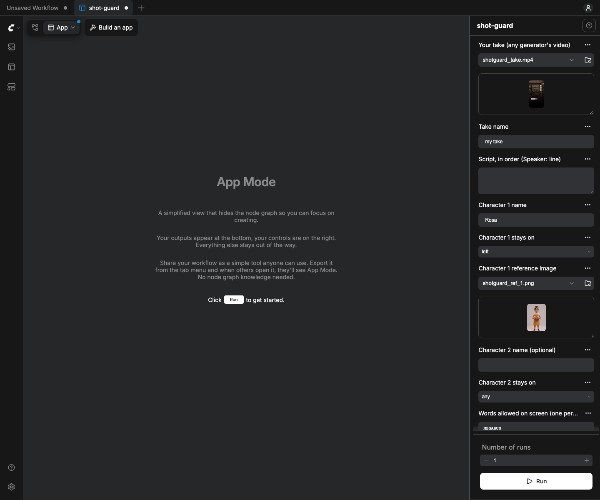
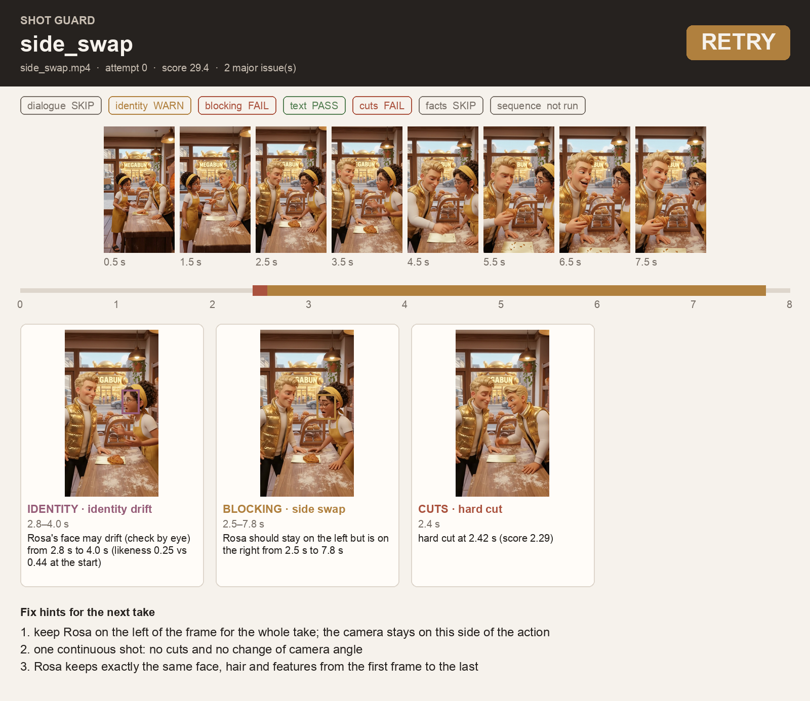
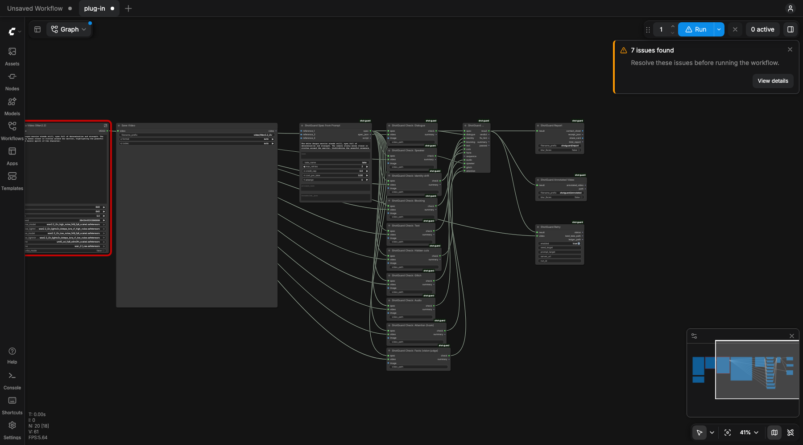
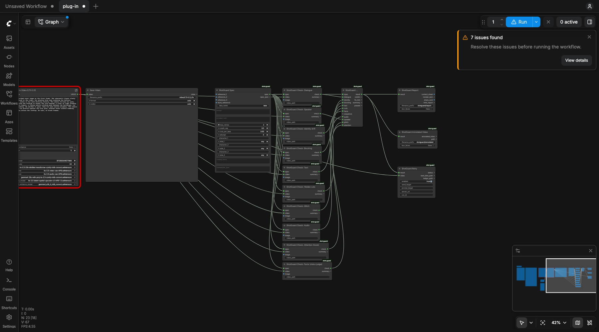
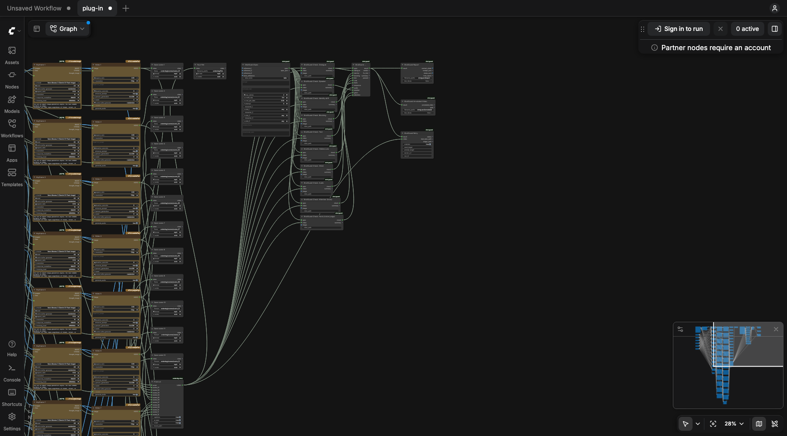
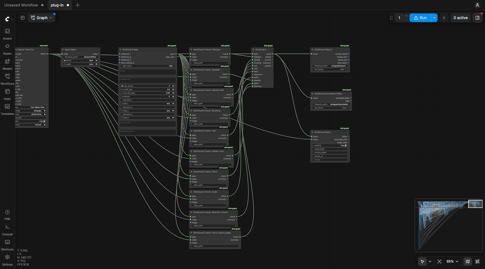
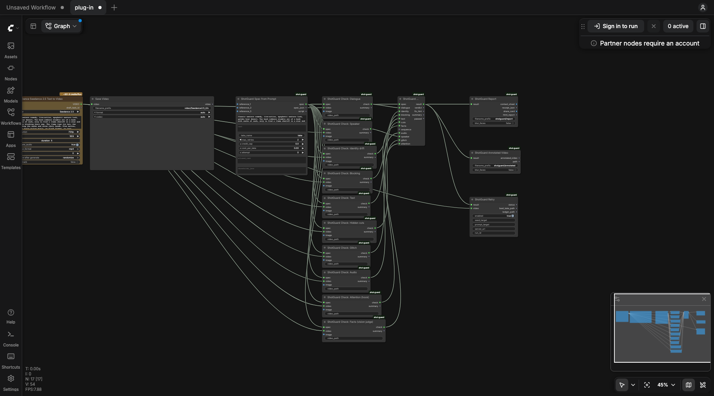

# Shot Guard

**A quality gate for AI video. Plug it in after any video node. It checks every take against the script and the
reference images, says what is wrong in plain English, and can re-queue the take with a fix hint under a credit cap.**

Video generators are good now. They still ship takes where the wrong person says the line, characters swap sides
mid-shot, a face changes in the last second, the sign on the wall is gibberish, or one "continuous" take hides a cut.
Today a person has to watch every take to catch that. Shot Guard watches for you.

Closed platforms sell a virality predictor: upload a finished video, get a hook and attention score. Shot Guard is the
open version of that idea, plus the step that comes before it: is the take even correct? It scores the hook and draws
an attention curve, and it checks the take against the script, the cast and the shot.

<p align="center"></p>

## What it checks

| Node | What it catches | How (all CPU) |
|---|---|---|
| **ShotGuard Spec** | The contract for the take: script lines in order with speakers, up to 3 characters with a reference image and the side of the frame they keep, the words allowed on screen, max retries, credit cap | plain Python |
| **ShotGuard Spec from Prompt** | The same spec, read from the prompt the generator gets: every quoted line becomes a script line, its speaker is the cast member named just before it (a short cast list maps names to the words the prompt uses: `Rosa: baker, yellow headscarf`), quotes after "sign" or "reads" become allowed text, "on the left" sets sides. When it can't tell who speaks ("He says", a crowd) it leaves the speaker blank rather than guess. On 40 lines from our own prompts: every line found, no wrong speaker | plain rules |
| **Check: Dialogue** | Missing lines, wrong words (word accuracy per line), extra speech, lines out of order, two speakers merged into one breath | whisper.cpp (`whisper-cli`) |
| **Check: Identity drift** | A face that stops looking like its reference: likeness curve per character (min / mean), worst frame. A **warning** unless the drop is large, because head turns and laughs look like drift too ([blind test](docs/BLIND-TEST.md)) | OpenCV YuNet face detection + SFace embeddings on face tracks |
| **Check: Blocking** | Characters swapping sides (crossing the line), characters leaving the frame | the same face tracks, x position over time |
| **Check: Text** | Garbled signs and screens ("MEGA-BUKEN" instead of "MEGABUN"), any text that is not on the allowed list (stray brand names) | Florence-2 OCR |
| **Check: Hidden cuts** | A scene cut inside what should be one continuous take (fast whips and morphs are shown as warnings) | colour histogram x pixel change, every frame |
| **Check: Facts** *(optional)* | Locked facts a model has to look at: "the van is plain white, no logos", "she wears the yellow headscarf". A vision LLM judges a few frames; a fact must break on 2+ of them | the Continuity Lock judge (vendored), any OpenAI-compatible endpoint that takes images |
| **Check: Audio** | Problems you hear: a silent track for a scripted take (fails), distortion from clipping, dead air mid-take, a music bed as loud as the voice (warnings). Thresholds measured on 24 real takes ([lessons](docs/LESSONS.md)) | numpy on 50 ms loudness windows, no model |
| **Check: Speaker** | The wrong person saying the line: while each line is heard, whose mouth moves most, compared with the script's speaker. Only judged when the scripted speaker is on screen; warns at 1.6x, fails at 2x. Found a line voiced by the other host in a take we had approved ([lessons](docs/LESSONS.md)) | YuNet mouth landmarks + SFace names + whisper.cpp timing |
| **Check: Glitch** | A frozen picture inside a moving shot (fails at 1 s), stutter from repeated frames, brightness flicker. Flags none of the 24 real takes | numpy on small grey frames, no model |
| **Check: Attention** | Will people keep watching? A hook score for the first 2 s, an attention curve every 0.25 s, and dead stretches with no speech and little movement. Rules, not a trained model of viewers: warnings only, never fails a take | movement, face size, speech, loudness |
| **Check: Sequence** | Takes of one scene in edit order: every character keeps the same side of the frame across each cut (the 180-degree rule) | the same face tracks |
| **ShotGuard Gate** | PASS / RETRY / FAIL, a score, and fix hints such as *"keep Rosa on the left of the frame for the whole take; the camera stays on this side of the action"* or *"speak the lines in this order, one at a time: 1) ... 2) ..."* | plain Python |
| **ShotGuard Retry** | On RETRY, queues this same graph again through the ComfyUI `/prompt` API with a new seed and the fix hint added to the prompt. Stops at max retries or before the credit cap, and keeps the best take | ComfyUI HTTP API |
| **ShotGuard Report** | A contact sheet: verdict, timeline with every flagged span, one card per problem with its frame, a box and the timecode, and the fix hints. Plus a JSON receipt | Pillow |
| **Clickable report** *(from Report)* | One self-contained HTML page per take: the take plays at the top, every finding is a button on the timeline and a card below, and clicking one jumps the video to that second. Attention curve under the timeline. No network, open it from disk | HTML + a few lines of JS |
| **Share card** *(from Report)* | A 1080x1350 image: the frame at the worst moment with its box, verdict, score dial, hook score and the top finding in one sentence | Pillow |
| **ShotGuard Annotated Video** | The take itself with the findings drawn on at the second they happen: a playhead on a timeline, check chips that light up, boxes on the person or sign, a red flash on a cut, and the verdict with the next fix hint at the end. Original sound kept. Share it instead of a bug list | Pillow + ffmpeg |
| **ShotGuard Auto-trim** | If a take's problem is a hidden cut, keeps the longest clean piece (2 s or more) instead of paying for a retry, and says whether anything else is still wrong | ffmpeg |
| **ShotGuard Dailies** | Point it at a folder of takes (each with its own spec, or one shared spec): checks them all, auto-trims hidden cuts, ranks them best first on one page, with a credits meter on top: takes checked, caught before the edit, retries saved | everything above |
| **ShotGuard Best of N** | Connect the Gate results of 2 to 4 takes of the same shot: ranks them (no major problem first, then score) and outputs the best take | plain Python |

Every check works on any model's output: open models, partner nodes, or a video you made somewhere else. Everything
except Facts is deterministic and runs on the CPU; Facts is the one place where a model has to look and judge.

## Caught on real takes

These are five takes from our own short film, made with a top commercial generator. Each one shipped past the
generator and was only caught when a person watched it. Shot Guard catches each of them, and passes the two takes we
approved. Contact sheets in [`docs/examples/`](docs/examples/) (faces blurred where the characters are based on real people).

| Take | The problem | Flagged by Shot Guard as |
|---|---|---|
| bakery argument | the two characters swap sides mid-take | Blocking: side swap at 2.5 s (also a hidden cut at 2.4 s) |
| the pitch | lines out of order, one line cut to "Why?", two speakers in one breath | Dialogue: out of order, wrong words, merged lines |
| scene 1 still | the sign reads "MEGA-BUKEN" instead of "MEGABUN" | Text: garbled, expected "MEGABUN" |
| street reveal | the camera angle jumps at 5.5 s | Hidden cuts: hard cut at 5.5 s |
| the recipe | one face changes after a cut at 4.7 s | Hidden cut at 4.7 s, plus an identity-drift warning from 4.8 s (likeness 0.61 against 0.78 at the start) |
| two approved takes | none | PASS (the new Speaker check adds one warning on one of them: its first line is voiced by the other host) |

<p align="center"></p>

## Tested on takes it had never seen

Passing the takes you tuned on proves little. Shot Guard was also run on 17 other takes from the same film, each
checked against the prompt it was made from, with half held out. v1 sent 13 of them back, almost all for the wrong
reason. After the fixes, 2 are sent back, both for real hidden cuts (caught on the held-out half, with no false fails). Full numbers, what changed and what was not measured:
[`docs/BLIND-TEST.md`](docs/BLIND-TEST.md).

## Install

Needs ComfyUI 0.42+ (frontend 1.41+ for App Mode), `ffmpeg` and `whisper-cli` on PATH. No GPU needed.

```bash
cd ComfyUI/custom_nodes
git clone https://github.com/jk-automations/shot-guard shot-guard
pip install opencv-python scipy transformers   # usually already in a ComfyUI install
brew install whisper-cpp ffmpeg                # or build whisper.cpp; any whisper-cli works
```

Models (all downloaded on first use except the whisper model):

| Model | Where it goes | From |
|---|---|---|
| YuNet face detector `face_detection_yunet_2023mar.onnx` (0.2 MB) | `ComfyUI/models/shot_guard/` (auto) | [opencv_zoo](https://github.com/opencv/opencv_zoo/tree/main/models/face_detection_yunet) |
| SFace recognizer `face_recognition_sface_2021dec.onnx` (37 MB) | `ComfyUI/models/shot_guard/` (auto) | [opencv_zoo](https://github.com/opencv/opencv_zoo/tree/main/models/face_recognition_sface) |
| Florence-2-base (0.5 GB) | `ComfyUI/models/LLM/Florence-2-base/` if present, else the Hugging Face cache (auto) | [microsoft/Florence-2-base](https://huggingface.co/microsoft/Florence-2-base) |
| whisper `ggml-base.en.bin` (148 MB) | `~/.cache/whisper.cpp/` or set `SHOTGUARD_WHISPER_MODEL` | [ggerganov/whisper.cpp](https://huggingface.co/ggerganov/whisper.cpp) |

Then open `workflows/shot-guard.json` (it opens in App Mode), pick a take and press Run.

**Facts** (optional) needs a vision model behind an OpenAI-compatible API: set `SHOTGUARD_JUDGE_URL` and
`SHOTGUARD_JUDGE_MODEL` (for example a local Qwen-VL server, LM Studio or Ollama). With no locked facts in the Spec it
never calls a model.

### CPU only

Everything runs on the CPU, so Shot Guard never competes with your generator for the GPU. On an Apple M3 Ultra an
8-second 720x1280 take takes about 5 s for faces, cuts and blocking, about 8 s for dialogue, and about 6 s per OCR frame
(one frame every 2 seconds by default; set `ocr_every` in `thresholds_json` to change it).

## Plug it into any workflow

Shot Guard only needs the video. Take whatever feeds your `Save Video` node and connect it to every check's `video`
input (and to Retry's `video`). Connect `Spec` to every check and to the Gate, each check to its Gate input, and the
Gate to Report, Annotated Video and Retry. `tools/plug_in.mjs` does exactly this for any workflow file, in the real
frontend, and fills in **Spec from Prompt** with the workflow's own positive prompt when it finds one. Ready-made graphs
are in [`workflows/examples/`](workflows/examples/): LTX-2.5, Wan 2.2, Seedance 2.5, Tiny World and Underdog Story.

```bash
node tools/plug_in.mjs http://127.0.0.1:8188 my-workflow.json my-workflow-guarded.json shot.png
```

After ComfyUI's stock **Wan 2.2 14B image-to-video** template; the spec is read from the template's prompt
(`workflows/examples/after-wan-2-2.json`). The notice in the corner is the template's own: its model files are not on our
test machine:



After ComfyUI's stock **LTX-2.5 image-to-video** template (`workflows/examples/after-ltx-2-5.json`):



After the Underdog Story film graph (partner nodes: Gemini, Nano Banana, Veo):



After the Tiny World graph (open models: Qwen-Image-Edit + LTX-2.5):



After ComfyUI's own **Seedance 2.5 text-to-video** template, unchanged (`workflows/examples/after-seedance-2-5.json`).
The template costs about 350 credits a run, which is what the credit cap is for:



### Auto-retry

Retry finds the seed (`seed` / `noise_seed`) and the positive prompt (the longest prompt text) by itself; set
`seed_target` / `prompt_target` to `node_id.input` (for example `3.seed`, `6.text`) to choose them. Each retry:

1. adds 1 to the seed,
2. replaces any earlier hint at the end of the prompt with the new one: `Shot Guard fix: ... Keep everything else identical.`,
3. adds 1 to the Spec's `attempt`, and queues the graph again.

It stops on the first PASS, after `max_retries`, or when one more take would pass `credit_cap` (spent =
takes x `cost_per_take`). The best take (PASS first, then the highest score) is copied to
`output/shot_guard/runs/<run_id>/best.mp4`, with a `ledger.json` of every attempt.

`workflows/shot-guard-retry-demo.json` shows the loop without spending anything: a mock generator stands in for the
video model and the seed picks a take.

## Tuning

`thresholds_json` on the Spec overrides any default in [`shotguard_core/spec.py`](shotguard_core/spec.py), for example
`{"line_accuracy": 0.7, "ocr_every": 2.0}`. How the defaults were measured: [`docs/LESSONS.md`](docs/LESSONS.md).

List **every** character who shows their face in the take, each with a reference, even when you only care about one.
Faces are named by elimination; with a single reference, two similar-looking characters can be confused.

Known limits:
- A face cut off by the frame edge is not scored for drift (half a face always looks different).
- Dialogue checks the words and their order, not who said them. We tried mouth movement and MediaPipe's jaw-open score;
  neither works on stylised faces. "Merged" uses the speakers you write in the script and whisper's punctuation.
- Identity and blocking need a visible face. A character seen only from behind is not tracked.
- OCR sees large text well; tiny or handwritten text is often missed or misread. Text under 3% of the frame height
  (background menus, chalkboards) is ignored; set `{"min_text_height": 0}` in `thresholds_json` for close-up ads.

## Licences

Shot Guard is Apache-2.0. Everything it runs is licensed for commercial use:

| Part | Licence |
|---|---|
| Shot Guard code | Apache-2.0 |
| Continuity Lock judge (`shotguard_core/continuity.py`, vendored from JK Automations' own pack) | MIT |
| OpenCV | Apache-2.0 |
| YuNet face detector (opencv_zoo) | MIT |
| SFace face recognizer (opencv_zoo) | Apache-2.0 |
| Florence-2-base | MIT |
| whisper.cpp | MIT |
| Whisper base.en weights | MIT |
| transformers | Apache-2.0 |
| PyTorch, NumPy, SciPy | BSD-3-Clause |
| Pillow | MIT-CMU |

No InsightFace: its face models are for non-commercial research only.

## Tests

```bash
python -m pytest -q          # logic, mocked retry loop, report and node tests run anywhere;
                             # the real-take tests need the local fixtures/ folder and skip without it
```

Built with ComfyUI by JK Automations.
